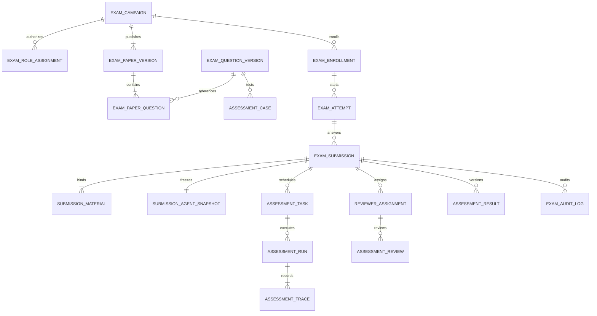

# 智能体考试平台系统分析与开发路线图

> 审计日期：2026-09-14  
> 审计对象：当前仓库代码、考试相关数据库结构、前后端路由、既有 PRD、测试与本机 `apboa_exam` 只读状态  
> 文档目的：回答“现在有什么、作为智能体开发考试平台缺什么、下一步先做什么”  
> 说明：本报告是代码与本机环境审计，不等同于生产环境安全测试，也没有修改任何业务代码或数据。

## 1. 结论先行

当前系统已经从通用智能体 SaaS 二次开发出一条考试 MVP 链路：管理员维护考试场次和试题，考生限时进入、创建智能体、填写作品表单并交卷，系统异步调用大模型初评，管理员查看成绩、人工复核并开放查分。

但它目前更准确的定位是“带考试页面的智能体作品收集与 AI 点评原型”，还不是一套可以支撑正式考试、保证公平性并对成绩负责的“智能体开发考试平台”。

阻断正式考试的核心问题不是缺少若干页面，而是以下五条基础链路尚未成立：

1. **考试授权不成立**：没有独立的考生、评委、组织方角色和评委分配；部分评审接口会主动忽略租户过滤，却没有服务端业务角色校验。
2. **作品真实性不成立**：提交时没有保存不可变的智能体配置与依赖快照；考后读取的是仍可变化的实时智能体配置。
3. **评测有效性不成立**：AI 当前只接收考生填写的 `form_json`，没有题目要求、智能体配置、附件正文、真实运行轨迹和测试结果，无法证明智能体实际完成了题目。
4. **成绩闭环不成立**：系统同时存在两套人工评分路径，其中一条只写 `assessment_review`，另一条才写 `assessment_result`；理论成绩也只有字段，没有导入或维护流程。
5. **运行可靠性不成立**：评测任务以数据库轮询方式领取但没有原子抢占、唯一活动任务约束、自动重试上限、超时回收和死信处理。当前本机库 17 个评测任务全部失败，尚未生成一份 AI 报告。

因此，下一步不应先扩展证书、排行榜或重型在线监考。推荐顺序是：

```text
可信交卷与授权
  → 可运营的考务后台
    → 能验证真实智能体能力的评测引擎
      → 可解释、可申诉的成绩闭环
        → 规模化、监控和高级考试能力
```

## 2. 审计范围、判断标准与假设

### 2.1 已检查的范围

- 通用平台架构：`common`、`biz/*`、`engine`、五个 runner、Vue 前端。
- 考试业务：`biz/biz-assessment`、`runner-console/.../assessment`、`ui/src/views/exam`、`ui/src/api/exam.ts`。
- 数据结构：`sql/once_db_init/20260731_exam_assessment.sql`、后续考试 SQL、考试库快照。
- 需求基线：`prototypes/exam-portal/智评工坊-考试门户PRD.md`。
- 运行证据：本机 `apboa_exam` 的表数量、状态分布与错误类型，只做聚合查询，不读取或展示个人明细、密钥值。
- 质量证据：考试模块单元测试、前端类型检查、根 Maven 聚合构建。

### 2.2 状态定义

| 状态 | 含义 |
|---|---|
| 已实现 | 前后端与数据链路基本存在，能够形成闭环 |
| 部分实现 | 有页面、接口或表，但缺少关键约束、流程或可靠性 |
| 未实现 | 仓库中没有对应领域对象或业务入口 |
| 存在风险 | 看似可用，但会影响权限、成绩可信度、安全或稳定性 |

### 2.3 产品假设

本路线图默认平台的核心场景是 B 端组织发起的“智能体开发实操考试”，而不是从零建设一套覆盖所有题型的通用 K12/LMS 考试系统。理论考试如需保留，优先通过标准导入或外部考试系统集成完成，不建议在当前阶段自建完整理论题库和在线答题引擎。

正式考试必须满足三个最低原则：

- **同等条件**：模型、预算、联网能力、可用工具和考试时长可控且可解释。
- **证据评分**：成绩依据来自冻结配置、实际运行轨迹、测试用例和人工复核，而不是考生自述。
- **全过程可追溯**：重要操作、规则版本、作品版本、评分版本和发布动作都能重放与审计。

## 3. 当前系统能力盘点

### 3.1 可复用的平台基础

原开源系统为考试平台提供了较强的“智能体开发底座”，这些不是当前主要缺口：

- 多租户账号、JWT/SK/ChatKey 鉴权。
- 智能体、模型、Prompt、知识库、MCP、工具、Skill、Hook、长期记忆和多智能体配置。
- AgentScope 运行时、AG-UI 流式交互、A2A、工作区、文件服务、命令代理和 WebSocket 服务。
- MySQL、Redis、向量库、对象/本地存储和 runner 分层部署。

这意味着后续应把精力放在“考试领域模型、约束和评测证据”上，而不是重写智能体编辑器。

### 3.2 当前考试 MVP 已具备的能力

| 领域 | 当前能力 | 判断 |
|---|---|---|
| 考试场次 | 创建、编辑名称与起止时间、启停、立即开考、查分开关 | 部分实现 |
| 试题 | 题目、分值、建议时长、场景、要求、成果、排序的 CRUD | 部分实现 |
| 报名 | `exam_enrollment` 表与“已报名才能进入”校验 | 部分实现；无管理流程 |
| 考前准备 | 考生可配置自己的模型供应商、模型和 API Key | 已实现但存在公平与安全风险 |
| 考试门户 | 待考/开考/结束状态、服务端时间、倒计时、门户进度 | 已实现 |
| 作答 | 每题创建一个作品草稿、自动保存、选择智能体、表单和附件上传 | 部分实现 |
| 交卷 | 手工交卷、服务端截止时间校验、后台自动交卷 | 部分实现 |
| SSO/跳转 | 一次性票据、过期和消费校验、returnUrl 策略 | 基本实现 |
| AI 初评 | 任务表、轮询 Worker、Ark 调用、结构化分数校验、失败展示与人工重试 | 部分实现；当前不可形成可信评分 |
| 人工复核 | 列表、详情、评分、评语、导出 Excel | 部分实现 |
| 查分 | 考试结束后由管理员开启，本人查看理论/实操/总分和作品入口 | 部分实现 |
| 考生监控 | 在线、已进入、提交状态、已用/剩余时间 | 基础实现 |
| 本地隔离 | 独立 MySQL、Redis DB、向量库、端口与工作目录 | 已实现本地方案 |

### 3.3 当前真实数据状态

2026-09-14 对本机 `apboa_exam` 做只读聚合检查，结果如下：

| 指标 | 当前值 |
|---|---:|
| 考试场次 | 3 |
| 报名记录 | 10 |
| 提交记录 | 17 |
| 其中超时自动交卷 | 15 |
| AI 任务 | 17 |
| AI 成功任务 | 0 |
| AI 失败任务 | 17 |
| 统一错误 | `Ark returned HTTP 401` |
| AI 报告 | 0 |
| 人工复核 | 0 |
| 最终结果 | 0 |

这个本机库不代表生产结果，但足以说明：当前“提交 → AI 报告 → 复核 → 最终成绩”的主链路没有被真实数据成功验证，不能以“页面已经存在”判断功能完成。

## 4. 上线阻断问题（P0）

### 4.1 考试业务权限与数据隔离不完整

**现状**

- 批次、试题和考生状态接口用固定用户名 `admin` 判断权限，没有考试业务角色。
- `ExamReviewerScoreController` 和 `ReviewerAssessmentController` 没有 `@RoleNeed`，也没有评委分配校验。
- 成绩列表、导出、详情和保存评分会调用 `TenantUtils.setIgnoreTenant()` 跨租户访问。
- 返回对象包含身份证号、电话、邮箱等信息。

**后果**

任何普通已登录账号只要知道接口即可尝试读取跨租户成绩和个人信息，甚至写入评分。前端隐藏菜单不是权限控制。

**必须完成**

- 新增独立考试角色：`EXAM_ADMIN`、`ORGANIZER`、`REVIEWER`、`CANDIDATE`、可选 `PROCTOR`。
- 新增批次级角色与评委分配表，所有考试接口在服务端做 `tenant + campaign + role + resource ownership` 四层校验。
- 禁止控制器直接裸用 `setIgnoreTenant()`；跨租户平台管理必须经过独立系统权限和审计。
- 评委只看到被分配作品，默认脱敏展示考生信息；盲评时不返回姓名与组织。

### 4.2 智能体归属校验实际只校验了租户

**现状**

- “我的智能体”列表只按 `tenant_id` 和 `enabled` 过滤，没有按创建者过滤。
- 交卷时也只验证 `agent.id + tenant_id + enabled`，没有验证 `created_by == currentAccountId`。

**后果**

同一租户内的考生可能选择并提交其他人的智能体，直接破坏考试公平性。

**必须完成**

- 以创建者、明确共享授权或考试工作区归属判断可提交性。
- 提交时再次校验，不信任前端列表。
- 对团队作品建立显式成员表，不允许以“同租户”替代作品所有权。

### 4.3 后端没有完成正式交卷校验

**现状**

- 姓名、身份证号、电话、作品名称、场景、功能说明、演示链接和原创声明等校验主要在 Vue 页面。
- 后端 `submit()` 只强制存在 `agentId`，直接调用接口可以绕过其他必填规则。
- `saveDraft()` 接受完整 `ExamSubmission` 实体和任意 `formJson`，没有 DTO Schema、长度、格式或附件绑定校验。
- 超时自动交卷会把空草稿也转为 `TIMEOUT_SUBMITTED` 并创建 AI 任务。

**后果**

可以提交无效 JSON、缺字段、自报附件、虚假声明或非法长度数据；空白超时草稿还会浪费模型调用，并污染成绩与监控。

**必须完成**

- 使用专用 Draft/Submit DTO，不允许直接接收实体。
- 服务端按批次规则校验字段、题目归属、声明、智能体、附件、版本号和考试窗口。
- 超时交卷区分 `NO_ANSWER`、`PARTIAL_TIMEOUT_SUBMITTED` 和有效超时提交；空白答卷不进入 AI 队列。
- 所有写操作接受幂等键并记录请求结果。

### 4.4 评测没有评到“题目”和“真实智能体”

**现状**

AI Worker 只把 `submission.form_json` 交给 `AssessmentPromptBuilder`。模型输入里没有：

- 当前题目的标题、任务要求、验收点和分值。
- 已选择智能体的不可变配置摘要。
- Prompt、Skill、MCP、知识库、工具等实际配置证据。
- 上传附件的正文、图片 OCR/视觉结果、视频元数据或哈希。
- 对智能体运行测试用例产生的输入、输出、工具调用和错误轨迹。

表单中的 `hasSkill`、`hasMcp`、`hasKnowledge` 等布尔值由考生自行勾选，当前 AI 评分只能判断“自述是否像一份完整说明”，不能判断智能体是否真实实现能力。

**后果**

AI 分数不能作为正式考试证据；写得好但没做出来的作品可能高分，真实完成但说明简短的作品可能低分。

**必须完成**

- 提交事务内冻结题目版本、评分规则版本、智能体配置快照与附件清单。
- 为每道题维护公开要求和隐藏测试用例。
- 在受控运行时执行智能体，记录完整但脱敏的评测轨迹。
- 客观规则评分优先，LLM Judge 只评价开放性指标，并接受抽样校准。
- 报告中每一分都能追溯到测试用例、运行轨迹或提交材料。

### 4.5 最终成绩存在两套不一致写入路径

**现状**

- `AssessmentReviewServiceImpl.publish()` 会写入 `assessment_result` 并把 submission 标记为 `PUBLISHED`。
- 管理员当前使用的 `ExamReviewerScoreServiceImpl.saveFinalScore()` 只写 `assessment_review`，不写 `assessment_result`，也不更新 submission。
- 考生查分优先读取 `exam_enrollment.practical_score`；为空时要求每份提交都有 `assessment_result` 才汇总。
- 理论成绩和实操成绩字段没有管理端录入、批量导入、校验、发布或纠错流程。

**后果**

管理员界面显示“已复核”不代表考生查分能看到最终成绩；不同接口会给出不同事实来源。

**必须完成**

- 合并为唯一的 Review/Result 应用服务和唯一发布命令。
- `assessment_result` 成为发布成绩的唯一事实来源，报名表不再保存可冲突的重复实操总分，或明确其为经过事务同步的汇总缓存。
- 增加批量发布、撤回、重发、成绩更正、版本和审计记录。
- 理论成绩通过模板导入/API 集成，保存来源、原始值、校验结果与操作人。

### 4.6 隐私、密钥和 SSRF 风险

**现状**

- 身份证和电话既出现在报名表的 ciphertext 字段，又以明文进入 submission `form_json`；本机库已有 10 份提交包含这两类明文。
- 考生 API Key 写入通用 `model_provider.api_key`；本机库存在 2 条非空考试模型 Key，实体没有加密 TypeHandler。
- 考生可以配置自定义模型 Base URL；校验只限制 HTTP(S) 和主机名，服务端会请求其 `/models`，没有阻止环回地址、私网地址、云元数据地址或 DNS rebinding。
- 试题附件和提交附件没有考试业务绑定表、下载授权与冻结记录。

**后果**

存在 PII 与密钥泄露、服务端请求伪造、材料替换和越权下载风险。

**必须完成**

- PII 使用字段级加密与脱敏 VO，禁止进入 `form_json`、日志和模型输入。
- 正式考试优先由平台提供统一模型；如保留 BYOK，使用密钥服务/信封加密、最小可见范围、到期删除和费用提示。
- 自定义 URL 默认关闭；如必须开放，使用出口代理、域名/IP 白名单、解析后 IP 校验和重定向复检。
- 新增 `submission_material`，保存 attachId、所有者、租户、哈希、扫描状态和快照；下载走短期签名和授权校验。

### 4.7 异步任务不能安全扩容

**现状**

- Worker 先查询一条 `QUEUED` 再更新为 `RUNNING`，没有 `SELECT ... FOR UPDATE SKIP LOCKED` 或带状态条件的 CAS 抢占。
- 数据库没有“同一 submission 只有一个活动任务”的唯一约束。
- 提交创建任务也是“先查后插”，并发下可能重复。
- 失败只能由考生手动重试，没有按错误类型自动退避、最大次数、死信队列、人工重放和熔断。
- 没有回收长期 `RUNNING` 僵尸任务的 watchdog。
- 任务进度只有 10/35/100，前端通过 2.5 秒轮询获取；已有 WebSocket 基础设施但考试事件未接入。

**必须完成**

- 原子领取任务，数据库唯一约束兜底。
- 引入持久队列或可靠 Outbox；短期可先把数据库队列做正确。
- 可重试错误指数退避，不可重试错误直接失败；配置最大次数、超时和死信。
- 记录模型请求耗时、Token、费用、错误分类，设置告警和容量限制。

## 5. 完整功能缺口目录

下表不是要求一次性全部开发。优先级含义：P0 为正式考试前必须完成，P1 为可运营 MVP，P2 为规模化与高级能力，P3 为条件成熟后再做。

### 5.1 考务与组织管理

| 缺口 | 优先级 | 建议 |
|---|---:|---|
| 独立考试角色与批次级授权 | P0 | 角色不能复用租户 Editor/Viewer，也不能写死用户名 |
| 考生名册导入、去重、错误报告 | P1 | 支持 Excel 模板、预校验、分批提交和结果回执 |
| 账号激活/邀请码/初始密码与重置 | P1 | 由组织方发放，不在 SQL 中手工插入 |
| 报名审核、禁考/取消资格及原因 | P1 | 状态机、操作者、时间和原因必须可审计 |
| 班级/组织/考场/分组 | P1 | 用于试卷分配、监考和统计 |
| 特殊时长、补考、缓考、单人延期 | P1 | 不修改整场考试时间；保存审批依据 |
| 公告、考前须知、联系入口 | P1 | 版本化并记录考生是否确认 |
| 批次复制、归档和删除保护 | P1 | 有提交数据的批次不可物理删除 |

### 5.2 题库、试卷和评分规则

| 缺口 | 优先级 | 建议 |
|---|---:|---|
| 题库与试卷分离 | P1 | 题目可复用；试卷决定题目、顺序、分值和规则 |
| 题目/试卷版本与发布锁定 | P0 | 开考后不能修改正在作答的题面与评分依据 |
| 每题 Rubric | P0 | 当前只有批次全局五维量表，不能表达不同题目的验收点 |
| 题目附件持久化与权限下载 | P0 | 当前页面上传字段未被 `ExamQuestionServiceImpl` 保存 |
| 试卷总分、分项上限和时长校验 | P1 | 发布前自动检查空题、重复题、总分和材料缺失 |
| A/B 卷、随机题序与抽题策略 | P2 | 先做固定 A/B 卷，再考虑复杂随机组卷 |
| 隐藏测试用例与评分权重 | P0 | 对考生不可见，对评测引擎可用 |
| 预览、模拟作答与试卷审批 | P1 | 组织方在发布前完整走一遍考生流程 |
| 题目统计与质量分析 | P2 | 难度、区分度、空答率、争议率、AI/人工差异 |

### 5.3 考试会话与答题体验

| 缺口 | 优先级 | 建议 |
|---|---:|---|
| 显式 `exam_attempt` | P0 | 把“进入考试、一次考试会话、每题提交”分开建模 |
| 签到/身份确认/规则确认 | P1 | 考前检查，不把身份信息反复写入答卷 JSON |
| 断网恢复与保存状态可见 | P1 | 明确“已保存到服务器”的时间和离线草稿冲突处理 |
| 多设备/多标签页控制 | P0 | 单活跃会话、设备变更提示和管理员解锁 |
| 服务端心跳和异常断线记录 | P1 | 当前在线状态来自通用 presence，不能代表考试会话健康 |
| 单人加时、统一暂停/恢复 | P1 | 考务事故处理所必需 |
| 强制收卷、撤销误交、允许补交 | P1 | 受角色、时间窗和审计控制 |
| 草稿历史与恢复点 | P2 | 防止误覆盖；只保留必要版本避免无限增长 |
| 无障碍与键盘操作 | P2 | 倒计时、步骤、错误提示满足基本可访问性 |

### 5.4 智能体考试环境与公平性

| 缺口 | 优先级 | 建议 |
|---|---:|---|
| 每位考生独立考试工作区 | P0 | 防止同租户互看/复用他人资源 |
| 标准模型、Token/费用/请求次数配额 | P0 | 正式考试不建议让考生任意 BYOK |
| 网络、MCP、工具与文件访问白名单 | P0 | 不同考生必须处于同等资源条件 |
| 考前模板与一键重置 | P1 | 预置必要资料，避免环境差异 |
| 开考前资源准备检查 | P1 | 模型、知识库、MCP、文件和运行节点健康检查 |
| 开考/交卷配置冻结 | P0 | 记录 Prompt、模型、工具、Skill、知识库版本与哈希 |
| 考后只读回放 | P1 | 回放冻结版本，不读取后来被修改的实时配置 |
| 资源清理和保留策略 | P1 | 到期释放模型配置、临时文件和敏感密钥 |

### 5.5 提交物与证据链

| 缺口 | 优先级 | 建议 |
|---|---:|---|
| `submission_material` 关系表 | P0 | 不把附件 ID 列表长期塞在任意 JSON 中 |
| 文件归属、类型、数量、大小后端校验 | P0 | 前端 `accept` 和大小检查不可作为安全边界 |
| 病毒扫描、哈希、解析状态 | P1 | ZIP 不执行；可只解析白名单文档 |
| 智能体配置快照 | P0 | 关联选中的智能体及所有依赖版本 |
| 题目/试卷/Rubric 快照 | P0 | 保证复核时看到的是交卷时规则 |
| 提交摘要与时间戳 | P1 | 对快照计算哈希，支持争议核验 |
| 材料预览和受控下载 | P1 | 短期 URL、权限校验、下载审计 |
| 外部链接证据策略 | P1 | 明确只登记、人工访问还是受控抓取；默认不抓取 |

### 5.6 智能体自动评测

| 缺口 | 优先级 | 建议 |
|---|---:|---|
| 测试用例定义与版本 | P0 | 输入、期望、断言、超时、权重、是否隐藏 |
| 真实运行执行器 | P0 | 在受控 runtime 运行冻结智能体，而不是只评表单 |
| 运行轨迹采集 | P0 | 输出、工具/MCP 调用、检索引用、耗时、Token、错误 |
| 规则断言 | P0 | 结构、关键词、引用、工具调用、文件产物等客观指标 |
| LLM Judge | P1 | 仅负责开放性质量指标；Prompt、模型、温度固定并版本化 |
| 重复运行与稳定性评分 | P1 | 检查偶然成功、输出方差与超时率 |
| 安全与指令注入测试 | P1 | 越权工具、提示注入、敏感信息泄露、幻觉 |
| 人工抽样与 AI 校准 | P1 | 计算 AI/人工差异，超过阈值暂停自动发布 |
| 评测成本预算 | P1 | 按场次、题目、考生统计 Token 与费用并限流 |
| 可复现评测包 | P2 | 快照 + 测试集 + 环境版本 + 轨迹可重新执行 |

### 5.7 评审、成绩和争议处理

| 缺口 | 优先级 | 建议 |
|---|---:|---|
| 评委分配与工作量均衡 | P0 | 只读被分配作品，支持批量分配和回收 |
| 盲评 | P1 | 隐藏考生、组织和可能暴露身份的信息 |
| 分项评分与调分理由 | P0 | 每题每维度受 Rubric 上限约束 |
| 双评、分差阈值与仲裁 | P2 | 高风险/高价值考试启用，不要求首期全量双评 |
| 统一成绩计算公式 | P0 | 理论/实操权重、四舍五入、缺考和零分规则可配置并版本化 |
| 批量发布与发布前校验 | P1 | 缺题、缺评、异常分数不能发布 |
| 撤回、更正、重评和版本历史 | P1 | 不能覆盖原结果；生成新版本并保留原因 |
| 申诉与复核工单 | P2 | 截止时间、证据、处理人、结论和通知 |
| 成绩单和证书 | P3 | 在成绩规则稳定后再做，避免把错误结果正式化 |

### 5.8 考试诚信与监考

| 缺口 | 优先级 | 建议 |
|---|---:|---|
| 操作审计日志 | P0 | 登录、进入、保存、交卷、配置变更、评分、发布均记录 |
| 多端登录与异常切换告警 | P1 | 先做轻监考，成本低且证据明确 |
| 作品/Prompt/材料相似度检测 | P1 | 辅助识别复制，不自动定罪 |
| 资源来源声明与团队成员声明 | P1 | 与快照、创建者和修改记录交叉核验 |
| 异常行为时间线 | P1 | 频繁切换、集中复制、临近截止突变等仅作风险提示 |
| 摄像头/录屏/锁屏浏览器 | P3 | 涉及隐私、客户端兼容和合规，确认业务必要性后再做 |

### 5.9 通知、运营与数据分析

| 缺口 | 优先级 | 建议 |
|---|---:|---|
| 考前、临期、交卷、评分失败、成绩发布通知 | P1 | 站内消息优先，短信/邮件按需接入 |
| 管理驾驶舱 | P1 | 报名、进入、在线、保存、交卷、评测、复核、发布漏斗 |
| 任务与基础设施监控 | P0 | 队列深度、成功率、P95、失败原因、节点健康、容量 |
| 成绩分布与题目分析 | P2 | 帮助调题与校准评分，不做简单排行榜 |
| AI 与人工评分一致性 | P1 | 偏差、相关性、各分段误差与异常样本 |
| 考务事件中心 | P1 | 记录断网、节点故障、加时、重试和人工处置 |
| 数据保留、导出和删除 | P1 | PII、密钥、答卷、轨迹分别设保留期 |

## 6. 目标领域模型

不建议继续把更多业务塞进 `exam_campaign.config_json` 和 `exam_submission.form_json`。最小可维护模型如下：



### 6.1 必须新增或重构的表

| 表 | 目的 | 最小关键字段 |
|---|---|---|
| `exam_role_assignment` | 批次级角色 | campaign_id, account_id, role, enabled |
| `exam_attempt` | 一次考试会话 | enrollment_id, started_at, deadline_at, status, device_hash, extra_minutes |
| `exam_paper_version` / `exam_question_version` | 冻结题面和规则 | version, status, published_at, content_hash |
| `assessment_case` | 公开/隐藏测试 | question_version_id, input_json, assertion_json, weight, visibility |
| `submission_material` | 绑定并冻结附件 | submission_id, attach_id, type, hash, scan_status, parse_status |
| `submission_agent_snapshot` | 冻结作品 | submission_id, agent_id, snapshot_json, snapshot_hash, captured_at |
| `assessment_run` / `assessment_trace` | 真实执行证据 | task_id, case_id, runtime_version, output, trace, tokens, latency, status |
| `reviewer_assignment` | 控制评委访问 | submission_id, reviewer_id, status, assigned_at |
| `assessment_result`（版本化） | 最终事实来源 | submission_id, version, score_json, total, status, published_at |
| `exam_audit_log` | 追溯关键操作 | actor, action, resource, before_hash, after_hash, reason, request_id |

### 6.2 数据库约束

至少增加：

- `(enrollment_id, question_id, del_flag)` 唯一，阻止并发重复答题记录。
- 每份 submission 同一 task_type 只有一个活动任务；不能只依赖“先查再插”。
- 评委分配 `(submission_id, reviewer_id)` 唯一。
- 成绩 `(submission_id, version)` 唯一，只有一个 `PUBLISHED` 当前版本。
- 外键是否采用数据库约束可遵循项目现有规范，但应用层必须完整校验关联归属。

当前初始 SQL 与考试库快照已经漂移：初始文件没有 `exam_submission.question_id` 和试题附件字段，快照中却存在；仓库也没有 Flyway/Liquibase。正式开发前需要建立可重复、可回滚、可验证的迁移机制。

## 7. 推荐技术架构

### 7.1 保留与拆分

- 继续保留 `biz-assessment` 作为考试领域模块。
- 控制器按 `candidate / reviewer / organizer / admin` 分包，并使用统一的考试授权服务。
- 第一阶段 Worker 可以仍在 `runner-console`，但领取逻辑必须支持多实例；达到正式考试规模后拆成独立 `runner-assessment-worker`。
- 真实智能体执行由 `runner-runtime` 提供内部评测 API，不能由 console 直接执行工具和代码。
- WebSocket 只负责通知；任务事实以数据库/可靠队列为准。

### 7.2 可信评测流水线


### 7.3 公平性建议

正式考试建议采用“平台统一供模 + 每人固定配额 + 受控工具白名单”。考生自带 API Key 可保留在练习模式，但不应默认用于正式排名型考试，原因是模型能力、上下文长度、稳定性、费用和限流都不同，会把资金和账号资源差异变成成绩差异。

## 8. 十二周开发路线图

以下排期假设：2 名后端、1 名偏 AI/运行时后端、1 名前端、1 名 QA，产品和运维兼职参与；两周一个 Sprint。若团队只有 2～3 人，建议保持顺序不变，将工期扩大到 16～20 周。

### Sprint 0（第 1 周）：冻结规则与修复交付基础

**目标：形成唯一产品定义和可执行质量门禁。**

- 确认正式考试与练习模式边界、理论考试是否外接、是否允许 BYOK。
- 确认一场考试的角色、试卷、计时、交卷、评分、发布和申诉规则。
- 修复 Java 21 构建环境、Lombok/编译插件和依赖版本；把后端测试、前端类型检查加入 CI。
- 引入数据库迁移工具，生成当前考试库 baseline，消除快照与增量 SQL 漂移。
- 建立最小威胁模型和 PII/密钥数据清单。

**验收门槛**

- 全新数据库可以通过一条命令迁移到当前版本。
- 根 Maven 测试和前端 `type-check` 在 CI 中稳定通过。
- 产品规则文档中不存在“由前端决定”或“由管理员直接改库”的关键流程。

### Sprint 1（第 2～3 周）：P0 权限、隐私与交卷完整性

**目标：任何一份答卷都满足“是谁、答哪题、交了什么、谁能看”。**

- 建立考试角色、批次授权、评委分配和统一 `ExamAuthorizationService`。
- 修复智能体创建者归属校验和跨租户评审越权。
- 专用 DTO + 后端 Schema 校验 + 幂等键 + 乐观锁。
- PII 从 `form_json` 移除并加密存储；VO 脱敏。
- 关闭正式考试自定义 Base URL/BYOK，或完成密钥加密与 SSRF 防护。
- 新增 `submission_material`，校验 attach 所有者、租户、类型、数量、大小和状态。
- 修复试题附件落库和下载授权。

**验收门槛**

- 考生 A 无法查看或提交考生 B 的智能体、答卷和附件。
- 普通账号无法访问任何评审、导出、考务接口。
- 绕过前端直接提交缺字段、假附件、旧版本或过期答卷全部被服务端拒绝。
- 数据库和日志中不再新增明文身份证、电话和 API Key。

### Sprint 2（第 4～5 周）：可运营考务后台与版本化试卷

**目标：不改数据库也能完整组织一场考试。**

- 考生名册 Excel 导入、预校验、账号激活、分组和状态管理。
- 批次生命周期、公告、规则确认、补考/加时/禁考。
- 题库、试卷、题目版本、每题 Rubric、题目附件和发布锁定。
- 考前预览、模拟作答与资源健康检查。
- 理论成绩标准模板导入；记录来源和错误回执。
- `exam_attempt`、考试心跳、单活跃会话和考务事件时间线。

**验收门槛**

- 组织方用 UI 从空库完成建场、导入考生、发布试卷、开考、加时和收卷。
- 开考后修改题库不会改变正在考试的题面和评分规则。
- 导入失败可定位到具体行列，重复导入不产生重复报名。

### Sprint 3（第 6～8 周）：真实智能体评测 MVP

**目标：评分依据从“自述”升级为“冻结作品 + 实际运行”。**

- 交卷时生成智能体与依赖快照、题目快照、材料哈希。
- 每题配置 3～10 个公开/隐藏测试用例和规则断言。
- Runtime 使用固定模型、配额、超时、网络/工具白名单执行测试。
- 采集输入、输出、工具/MCP/RAG 轨迹、耗时、Token 和错误。
- 规则分 + LLM Judge 分组合，评分版本固定。
- 报告逐项链接证据；缺证据不能自动给高分。
- 原子任务领取、自动重试、超时回收、死信和管理员重放。

**验收门槛**

- 一个仅填写漂亮说明但智能体无法通过测试的作品不能获得高分。
- 同一快照、测试集和评测版本可重跑并解释差异。
- 多实例 Worker 不会重复执行或重复扣费。
- 模型 401、429、超时、非法 JSON 和 runtime 故障均有明确分类和告警。

### Sprint 4（第 9～10 周）：统一复核与成绩发布

**目标：管理员、评委和考生看到同一份成绩事实。**

- 合并两套人工评分服务和页面调用路径。
- 评委工作台、分项评分、调分理由、保存草稿、提交复核。
- 组织方批量发布前检查缺评、异常分和 AI/人工偏差。
- 版本化结果、批量发布、撤回、更正、重评。
- 理论/实操权重、缺考、零分和四舍五入规则配置化。
- 考生成绩单展示评分依据和允许公开的信息。
- 建立最小申诉/复核工单。

**验收门槛**

- 任意成绩从发布页、考生页和导出表读取一致。
- 已发布结果不能被覆盖，只能生成带原因的新版本。
- 未分配评委无法打开详情，已分配评委无法评其他作品。

### Sprint 5（第 11～12 周）：压测、监控、灾备与正式考试演练

**目标：证明系统能承受真实考试，而不是只在单机演示可用。**

- 全链路指标、看板和告警：在线人数、保存/交卷成功率、队列深度、P95、模型失败率和费用。
- 备份恢复、考试数据导出、日志与数据保留策略。
- 100/300/目标峰值考生压测，重点覆盖倒计时附近保存与集中交卷。
- 故障演练：Redis 不可用、模型不可用、runtime 重启、文件服务慢、数据库主从切换。
- 安全测试：水平越权、角色越权、SSRF、上传、提示注入、敏感信息泄露。
- UAT：管理员、考生、评委三角色跑完整模拟考试；形成考务 Runbook。

**验收门槛**

- 集中交卷不丢答卷、不重复评测，故障恢复后任务可继续。
- 关键告警在 5 分钟内可被发现并定位。
- 备份恢复演练成功，正式考试有降级方案和人工处置步骤。

## 9. 第一批建议直接创建的研发工作包

按执行顺序列出，前 8 项完成前不建议举办计入正式成绩的考试。

1. **EXAM-001：考试业务 RBAC 与评委分配**  
   建表、授权服务、控制器守卫、跨租户审计；补齐水平/垂直越权集成测试。
2. **EXAM-002：智能体所有权与考试工作区隔离**  
   修复列表和提交校验；定义团队作品授权；正式考试每人独立空间。
3. **EXAM-003：后端交卷 DTO、Schema 与幂等**  
   服务端校验所有必填规则、附件、题目、版本和窗口；空白超时答卷不进评测。
4. **EXAM-004：PII、API Key 与自定义 URL 安全整改**  
   清理双写明文、迁移存量、加密密钥、关闭/隔离 SSRF 入口。
5. **EXAM-005：材料绑定与试题附件修复**  
   `submission_material`、哈希、归属、扫描、下载授权；修复试题附件未保存。
6. **EXAM-006：冻结快照与审计日志**  
   冻结题目、Rubric、智能体和依赖；记录提交哈希及关键操作。
7. **EXAM-007：统一复核与结果发布服务**  
   删除事实冲突，建立版本化结果、理论成绩导入和批量发布。
8. **EXAM-008：可靠评测任务队列**  
   原子领取、唯一约束、重试、watchdog、死信、指标和告警。
9. **EXAM-009：考生名册与考务后台**  
   导入、激活、分组、加时、禁考、状态、通知和错误回执。
10. **EXAM-010：题目版本、测试用例与真实运行评测**  
    每题 Rubric、隐藏测试、运行轨迹、规则断言、LLM Judge 和证据报告。

## 10. 测试策略与发布门禁

### 10.1 当前测试结论

- 考试模块有 13 个测试类、24 个已发现的测试用例，集中在量表、分数校验、SSO 工具类和少量服务。
- 没有考试控制器授权集成测试、数据库状态机测试、并发交卷测试、Worker 多实例测试或考试前端 E2E。
- 前端直接运行 `vue-tsc --noEmit` 通过。
- `pnpm type-check` 被当前 pnpm 的 ignored build scripts 策略阻断。
- 根 Maven 聚合测试在 `common-base` 编译失败；当前 Maven 使用 Java 26，而项目要求 Java 21，错误表现为 Lombok 生成的构造器/getter/log 缺失。
- 仅运行 `biz-assessment` 时，21 个用例通过、3 个模型配置用例因已安装的 `common` SNAPSHOT 缺少 `ModelEndpointValidator` 而失败，说明本地依赖与源码版本不一致。

这不是本次文档修改造成的，但说明当前构建不能作为可靠发布门禁。

### 10.2 必须新增的自动化测试

| 层级 | 最低覆盖 |
|---|---|
| 单元测试 | 状态机、计分、时间窗、快照、脱敏、重试策略、结果版本 |
| 服务集成 | 角色授权、所有权、跨租户、事务、唯一约束、幂等、附件归属 |
| API 契约 | 考生/评委/组织方所有接口的成功与越权响应 |
| 并发测试 | 自动保存与交卷竞争、重复点击、多个 Worker 抢同一任务 |
| 前端 E2E | 考前、答题、断网恢复、超时、评测失败、复核、查分 |
| 安全测试 | IDOR、SSRF、上传、敏感字段、日志泄露、Prompt injection |
| 压测 | 登录、轮询/心跳、自动保存、截止秒集中交卷、评测队列 |
| 灾备测试 | runner 重启、Redis/模型/文件服务故障、任务恢复、数据库恢复 |

### 10.3 正式考试发布门禁

必须同时满足：

- P0 工作包全部完成，无未解释的高危权限或隐私问题。
- 全量构建与测试在固定 Java 21/Node 环境通过。
- 目标峰值 1.5 倍压测通过，答卷零丢失、评测不重复。
- 至少完成两次完整模拟考试和一次故障演练。
- AI 与人工评分校准达到业务设定阈值；未达到时 AI 只能给建议分，不能自动发布。
- 备份、恢复、考务 Runbook、人工兜底和联系人明确。

## 11. 关键产品决策清单

以下问题必须由产品/考试负责人定案，技术不应擅自默认：

1. 正式考试是否允许考生自带模型和 API Key？推荐：不允许，统一供模。
2. 考试是个人作品还是允许团队作品？团队作品需要成员、贡献和授权模型。
3. 是否真的需要身份证号？若学号/培训编号足够，应减少敏感信息收集。
4. 理论考试是自建、外接还是只导入成绩？推荐首期外接或导入。
5. AI 初评占最终成绩多少？推荐首期仅辅助，人工发布最终结果。
6. 哪些题目可以规则自动评分，哪些必须人工判断？应按题目配置。
7. 是否允许外网、哪些 MCP/工具可用、费用上限是多少？需要形成考试环境矩阵。
8. 交卷后是否允许修改智能体？推荐冻结提交版本，原工作区可继续修改但不影响已交卷快照。
9. 异常断网、平台故障、模型故障如何补时或重评？必须有统一考务政策。
10. 是否需要摄像头/录屏？推荐先做轻监考和证据链，确认合规与必要性后再做重监考。

## 12. 不建议现在优先做的功能

- 证书、勋章、排行榜和社交分享。
- 复杂随机组卷算法。
- 全量双盲多评委体系。
- 自研完整理论考试引擎。
- 摄像头、录屏和锁屏浏览器。
- 仅用于“看起来像 AI”的动画和大屏。

原因不是这些功能没有价值，而是当前系统首先需要证明成绩是安全、真实、一致、可重放的。否则外围功能只会放大错误结果。

## 13. 代码证据索引

| 结论 | 主要证据 |
|---|---|
| 考试核心只有 9 类实体 | `common/src/main/java/com/hxh/apboa/common/entity/Exam*.java`、`Assessment*.java` |
| 没有评委分配、材料、快照、审计表 | `sql/once_db_init/20260731_exam_assessment.sql` |
| 批次后台只能编辑名称、时间和启停 | `ExamCampaignUpdateRequest.java`、`ExamCampaignAdminServiceImpl.java` |
| 管理权限写死用户名 admin | `ExamCampaignAdminController.java`、`ExamQuestionController.java`、`ExamCandidateStatusController.java` |
| 评审接口没有业务角色守卫 | `ExamReviewerScoreController.java`、`ReviewerAssessmentController.java` |
| 成绩服务跨租户扫描 | `ExamReviewerScoreServiceImpl.java:75-77,250-255,447-450,555-557,1025-1028` |
| 智能体列表不按创建者过滤 | `ExamSsoServiceImpl.java:115-125` |
| 交卷只按租户确认智能体 | `ExamSubmissionServiceImpl.java:99-118` |
| 后端没有表单和附件完整校验 | `ExamSubmissionServiceImpl.java:53-80,83-119` |
| 空草稿超时后仍创建评测任务 | `ExamDeadlineWorker.java`、`ExamSubmissionServiceImpl.java:179-244` |
| AI 只收到 form_json | `AssessmentTaskWorker.java:72-81`、`AssessmentPromptBuilder.java:18-45` |
| 评分发布存在两条不同路径 | `AssessmentReviewServiceImpl.java:55-91`、`ExamReviewerScoreServiceImpl.java:1023-1068` |
| 候选人模型 Key 直接写 provider | `ExamCandidateModelConfigServiceImpl.java:109-153`、`ModelProvider.java:44-52` |
| 自定义模型 URL 只做格式校验 | `ModelEndpointValidator.java:15-37`、`ExamCandidateModelConfigServiceImpl.java:192-220` |
| 任务领取没有原子抢占 | `AssessmentTaskWorker.java:39-70` |
| 数据库没有活动任务/答题唯一约束 | `20260731_exam_assessment.sql` 与本机 `SHOW INDEX` 结果 |
| 试题附件 UI 有字段但服务层未保存 | `ExamCampaignAdminPage.vue:387-405`、`ExamQuestionServiceImpl.java:29-57` |
| 前端依赖轮询而非考试事件推送 | `CandidateAssessmentPage.vue:101-110` |

## 14. 最终建议

下一阶段的北极星不应是“增加了多少考试页面”，而应是：

> 任取一名考生、一份答卷和一个最终分数，平台都能证明该考生在规定时间、规定资源条件下，提交了哪个不可变的智能体版本；系统用哪些测试和证据得到了什么初评；哪位评委依据哪个 Rubric 做了什么调整；成绩何时由谁发布、是否被更正过。

当这条证据链成立后，报名、通知、证书、统计和监考等功能才有稳定的业务地基。建议立即启动 Sprint 0 与 Sprint 1，并暂停把当前 AI 初评分数用于正式成绩发布。
