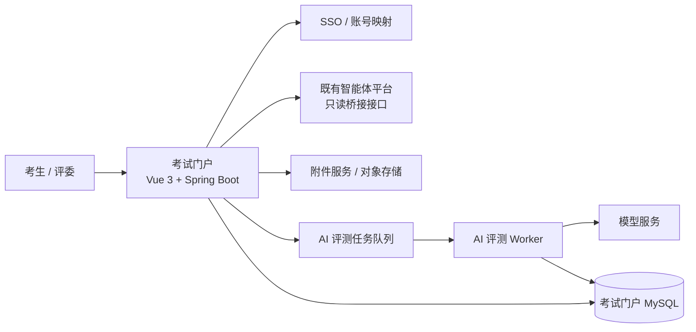
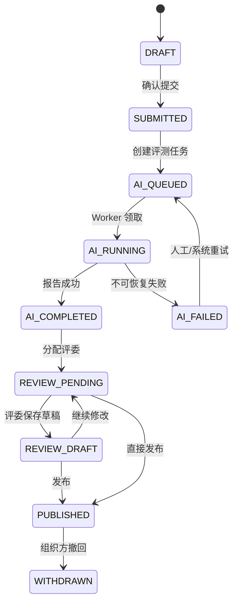

# 智评工坊考试门户 PRD（研发实施版）

> 版本：V1.1  
> 日期：2026-07-31  
> 原型基线：[智评工坊-学员端-整合原型.html](./智评工坊-学员端-整合原型.html)  
> 定位：独立考试门户；智能体制作复用现有 Apboa-Next 平台；第一期采用“材料型 AI 初评 + 单评委最终评分”。

## 1. 背景、问题与目标

培训考生需要在现有智能体平台内创建智能体，但考试报名、作品提交、AI 智评、评委复核和成绩发布缺少一条统一链路。现有智能体平台不应承担考试业务的全部复杂度，因此新建独立考试门户，通过单点登录和受控只读接口与平台集成。

### 1.1 本期目标

1. 考生在考试门户完成注册/报名后，可无重复登录进入智能体制作平台。
2. 考生通过四步向导提交作品信息和材料，并选择自己在平台内创建的智能体。
3. 系统异步生成 AI 初评：五项建议分、证据、置信度、风险和改进建议。
4. 单评委完成复核评分和评语，发布最终成绩。
5. 全流程有状态、权限校验、审计记录和失败重试能力。

### 1.2 明确不做

- 不重做智能体编辑器、模型配置、Skill/MCP 配置页面。
- 不共享或直连既有平台数据库。
- 不自动访问考生填写的外部演示链接。
- 不解压或执行考生上传的 ZIP、代码包或 Skill 包。
- 不做多人盲评、申诉、证书自动签发、在线监考；作为后续迭代。
- 不冻结考生智能体。考生提交后仍可修改智能体；初评只读取提交时捕获的**脱敏配置摘要**和提交材料。

## 2. 总体架构



### 2.1 服务边界

| 服务 | 职责 | 禁止职责 |
|---|---|---|
| 考试门户前端 | 考生/评委页面、向导状态、任务轮询或 WebSocket 消息展示 | 保存密钥、绕过权限、直连既有平台数据库 |
| 考试门户后端 | 考试、报名、提交、评分、权限、审计、AI 任务编排 | 执行考生代码或外部 URL |
| 智能体平台桥接 | 用户 SSO、我的智能体列表、脱敏智能体摘要 | 暴露模型 API Key、MCP 密钥、知识库原文 |
| AI Worker | 材料整理、文本/图片解析结果编排、结构化初评 | 最终定分、访问外网演示链接 |
| 附件服务 | 上传、病毒扫描、解析、受控下载 | 按无鉴权公网 URL 暴露材料 |

## 3. 角色、权限与数据隔离

### 3.1 业务角色

| 角色 | 读取权限 | 写入权限 |
|---|---|---|
| 考生 `CANDIDATE` | 本人报名、本人提交、本人 AI 初评、已发布成绩 | 报名资料、草稿、正式提交 |
| 评委 `REVIEWER` | 被分配提交、材料、配置摘要、AI 初评 | 评分草稿、最终评分、发布（若配置允许） |
| 组织方 `ORGANIZER` | 本批次全部数据、统计、审计 | 批次、Rubric、评委分配、成绩撤回/重发 |
| 系统管理员 `SYSTEM_ADMIN` | 租户与系统诊断 | SSO、模型、存储等系统配置 |

### 3.2 强制授权规则

1. 所有 `/exam/**` 接口先鉴权账号，再校验 `campaignId` 和业务角色。
2. 考生访问 submission 时必须满足 `submission.enrollment.account_id == currentAccountId`。
3. 评委访问 submission 时必须存在启用中的 `assessment_reviewer_assignment`。
4. 组织方必须是该考试批次所属租户的组织方成员；不能只依赖前端隐藏按钮。
5. 从智能体平台读取作品时，桥接服务必须校验 `agent.created_by == currentAccountId` 或存在明确的提交授权。

### 3.3 与现有 TenantRole 的关系

`TENANT_OWNER/ADMIN/EDITOR/VIEWER` 是既有平台资源权限，不能直接作为考试业务角色。考试门户新增独立业务授权表；平台内考生编辑权限仍按现有平台管理。第一期可为培训考生配置受限 Editor，但桥接接口必须以 `created_by` 过滤“我的智能体”。

## 4. 状态机

### 4.1 报名状态 `exam_enrollment.status`

```text
DRAFT -> REGISTERED -> VERIFIED -> ACTIVE -> DISQUALIFIED
```

- `DRAFT`：保存但未完成基础信息。
- `REGISTERED`：完成报名，可进入创作与提交。
- `VERIFIED`：组织方完成身份核验（如需要）。
- `ACTIVE`：当前可提交；通常可由 `REGISTERED/VERIFIED` 派生，无需人工切换。
- `DISQUALIFIED`：不可继续提交，保留原因。

### 4.2 作品状态 `exam_submission.status`



### 4.3 状态转换约束

| 操作 | 前置状态 | 后置状态 | 操作者 | 幂等要求 |
|---|---|---|---|---|
| 保存草稿 | `DRAFT` | `DRAFT` | 考生 | 同一请求键重复调用不产生新记录 |
| 正式提交 | `DRAFT` | `SUBMITTED` | 考生 | submission 版本号校验；已提交返回当前记录 |
| 创建 AI 任务 | `SUBMITTED` | `AI_QUEUED` | 系统 | 同一 submission 仅一个 active 任务 |
| 重试 AI | `AI_FAILED` | `AI_QUEUED` | 组织方/系统 | 最大重试次数可配置，默认 2 次 |
| 保存复核 | `REVIEW_PENDING/REVIEW_DRAFT` | `REVIEW_DRAFT` | 评委 | 覆盖同一评委草稿并记录审计 |
| 发布成绩 | `AI_COMPLETED/REVIEW_PENDING/REVIEW_DRAFT` | `PUBLISHED` | 有发布权评委/组织方 | 二次确认；写入不可变结果版本 |

## 5. 学员端详细需求

### 5.1 门户首页

**页面目标**：让考生在 5 秒内理解当前考试、截止时间和下一步动作。

| 区块 | 内容 | 交互 |
|---|---|---|
| 顶部导航 | 考试门户、我的作品、AI 智评、当前用户 | 根据登录态显示；未登录跳转统一登录 |
| 考试通知 | 批次名称、提交截止时间、公告 | 由组织方维护；到期显示“已截止” |
| 主视觉 | 考试简介、去制作智能体、提交作品 | 两个主按钮；若无报名先引导报名 |
| 进度卡 | 报名、制作/提交、AI 智评、评委发布 | 从后端状态派生，不允许前端手工伪造 |
| 流程说明 | 制作 → 向导提交 → AI 智评 → 评委复核 | 纯说明，无业务写入 |

### 5.2 SSO 制作引导

1. 考生点击“去制作智能体”。
2. 门户服务端创建一次性 `sso_ticket`，绑定 `accountId`、`tenantId`、`campaignId`、`returnUrl`、过期时间（5 分钟）。
3. 浏览器跳转至既有平台 `/sso/exam-login?ticket=...`。
4. 平台消费票据并建立平台会话；成功后显示“我的智能体”。
5. 平台“返回考试门户”按钮带 `campaignId` 返回门户 `/candidate/submission?campaignId=...`。

**安全要求**：ticket 必须签名、一次性消费、服务端存储 `jti`；`returnUrl` 仅允许白名单域名；不得把 JWT、平台密码或模型凭据放在 URL 中。

### 5.3 四步向导

#### 通用交互

- URL 不要求反映具体步骤，但页面刷新后应读取草稿 `current_step` 恢复到最后已保存步骤。
- 每个“下一步”先执行当前步骤校验，再 `PUT /submissions/{id}/draft` 保存；保存成功才切换。
- “上一步”不校验但保存当前可编辑内容。
- 草稿自动保存：输入停止 1 秒后保存；失败显示非阻塞提示，不应覆盖用户未保存输入。
- 提交窗口关闭后，草稿可查看但不能编辑/提交。

#### 第一步：身份核验

| 字段 | 类型 | 必填 | 校验/存储 |
|---|---|---:|---|
| 姓名 | string(50) | 是 | 去首尾空格 |
| 身份证号 | string(64) | 按批次配置 | 国标格式校验；字段级加密；返回仅脱敏值 |
| 联系电话 | string(32) | 是 | 手机/座机格式；脱敏展示 |
| 所属单位 | string(200) | 是 | 普通文本 |
| 课程批次 | display/select | 是 | 必须等于当前 `campaignId`，前端不可任意改写 |

#### 第二步：智能体作品信息

| 字段 | 类型 | 必填 | 说明 |
|---|---|---:|---|
| 智能体选择 | agentId | 平台内作品是 | 仅拉取本人可提交智能体；同时保存 `agent_summary` |
| 作品类型 | enum | 是 | `PLATFORM_AGENT` / `EXTERNAL_WORK`；默认平台内 |
| 应用场景 | text | 是 | 1-1000 字 |
| 功能说明 | text | 是 | 1-2000 字 |
| 创新性说明 | text | 否 | 0-1500 字 |
| 推广性说明 | text | 否 | 0-1500 字 |
| 数据说明 | text | 否 | 0-1500 字；提示不得填入敏感原文 |
| 运行环境 | textarea | 否 | 多行，0-1500 字 |
| 团队分工 | text | 否 | 0-1000 字 |
| 技术说明 | text | 是 | 1-3000 字 |
| 能力勾选 | JSON array | 否 | `skill`、`mcp`、`demo`、`knowledgeBase` |

平台智能体摘要最少包含：智能体名称、描述、模型显示名、Prompt 摘要/长度、Skill 名称列表、MCP 名称列表、知识库名称列表、最后更新时间。不得返回 API Key、连接字符串、完整系统提示词或知识库内容。

#### 第三步：资料上传

| 材料类型 | 必填 | 限制 | AI 使用方式 |
|---|---:|---|---|
| 演示链接 | 是（可配置） | 仅 URL 格式和长度校验 | 作为材料文本；**不访问** |
| 演示视频 | 是 | mp4/mov，建议 3-8 分钟，大小阈值配置 | 视频元数据；后续可接多模态解析 |
| 系统截图 | 是 | png/jpg/webp，建议 3-6 张 | OCR/视觉解析结果（若启用） |
| 代码/技能包 | 是（可配置） | zip，大小阈值配置，病毒扫描 | 文件名、清单、说明文本；不执行 |
| 补充材料 | 否 | pdf/docx/xlsx/pptx/txt/图片 | 提取文本后作为证据来源 |

上传成功仅获得 `attachId`；提交时必须由后端校验附件归属当前账号和当前考试租户。附件删除后不得出现在已提交材料中。

#### 第四步：确认提交

展示：身份摘要、智能体摘要、必填字段完成情况、材料清单、版权声明。

提交前校验：

1. 报名有效、在提交窗口内。
2. 前三步必填字段、附件和声明全部满足。
3. 已选择平台内智能体时，桥接接口再次校验其归属。
4. 用乐观锁 `version` 防止多标签页覆盖。
5. 写入 `submitted_at`，创建 AI 任务 Outbox 事件；同一事务提交。

### 5.4 AI 推演动效

**目的**：反馈异步任务正在进行，避免用户误以为页面卡死；动效不是虚假的固定倒计时，必须映射真实任务状态。

| 后端任务状态 | 页面文案 | 进度建议 |
|---|---|---:|
| `QUEUED` | 正在初始化评分引擎 | 10% |
| `COLLECTING` | 正在解析考生提交材料 | 25% |
| `EVIDENCE_EXTRACTING` | 正在提取智能体技术证据 | 45% |
| `SCORING` | 正在对齐评分标准 Rubric | 70% |
| `REPORTING` | 正在生成风险与改进建议 | 90% |
| `SUCCEEDED` | AI 智评完成 | 100% 后跳转报告 |
| `FAILED` | AI 智评暂未完成 | 显示失败原因、重试状态和联系入口 |

前端优先使用 WebSocket/SSE 接收 `assessmentTaskStatus`；第一期若无推送，可每 2 秒轮询 `GET /assessment-tasks/{id}`，最大 10 分钟，之后提示后台继续执行并提供“刷新结果”。

### 5.5 AI 初评报告

报告必须使用以下信息架构，避免“总分”和“结论”重复：

1. **AI 评估概览**：总分 `102 / 120`、评分覆盖 `5/5`、材料置信度。
2. **初评结论**：建议状态、整体判断、作品亮点、待核验项。
3. **五项评分卡**：建议分/满分、简短理由、进度条。
4. **评分证据**：以“证据标题 + 引用材料说明”展示；可定位到表单字段或附件。
5. **风险点与改进建议**：将 AI 不能确认的内容明确标为评委核验项。

固定提示：`AI 初评为辅助分析，最终成绩以评委发布结果为准。`

## 6. AI 智评详细设计

### 6.1 输入包构建

输入包由 Worker 构建，不允许前端直接拼 Prompt。

```json
{
  "campaign": {"id": 1, "name": "智能体开发专题班", "rubricVersion": "2026.1"},
  "submission": {
    "workType": "PLATFORM_AGENT",
    "form": {"scene": "...", "function": "...", "technology": "..."},
    "agentSummary": {"model": "...", "skills": ["inspect-skill"], "knowledgeBases": ["巡检规范"]},
    "materials": [{"id": 101, "type": "VIDEO", "name": "演示视频.mp4", "extractedText": "..."}]
  },
  "rubric": [{"code": "SCENE_VALUE", "maxScore": 20, "criteria": "..."}]
}
```

输入裁剪规则：附件单文件提取文本和总文本均有 Token 上限；超出时保留目录、标题、首尾和高相关片段，并记录 `truncated=true`。任何密钥、身份证号、手机号、连接 URI 均在进入模型前脱敏。

### 6.2 Rubric

| code | 名称 | 满分 | 核心判断 |
|---|---|---:|---|
| `SCENE_VALUE` | 场景价值 | 20 | 痛点真实、对象清晰、预期收益/推广价值 |
| `FUNCTION_COMPLETENESS` | 功能完整度 | 25 | 输入-处理-输出闭环、异常/边界说明 |
| `INNOVATION` | 创新性 | 20 | 方案或业务创新；不用“堆组件”替代创新 |
| `TECHNICAL_DESCRIPTION` | 技术说明 | 30 | 模型、Prompt、RAG、Skill/MCP、运行条件可理解 |
| `VERIFIABILITY` | 可验证性 | 25 | 视频/截图/文档一致，材料能支撑复核 |

### 6.3 结构化输出 Schema

```json
{
  "overallScore": 102,
  "overallMaxScore": 120,
  "recommendation": "RECOMMEND_REVIEW",
  "overallConfidence": "HIGH",
  "summary": "...",
  "dimensions": [
    {
      "code": "SCENE_VALUE",
      "name": "场景价值",
      "score": 18,
      "maxScore": 20,
      "reason": "...",
      "confidence": "HIGH",
      "evidenceRefs": ["FORM.scene", "FORM.function"],
      "reviewRequired": false
    }
  ],
  "evidence": [{"id": "E-001", "title": "场景与功能匹配", "sourceRef": "FORM.function", "content": "..."}],
  "risks": [{"severity": "MEDIUM", "title": "异常处理说明不足", "detail": "...", "reviewAction": "核验视频或补充材料"}],
  "suggestions": ["..."],
  "modelMeta": {"model": "...", "promptVersion": "assessment-v1"}
}
```

后端必须校验：所有分数为整数、`0 <= score <= maxScore`、总分等于五项和、维度 code 完整且不重复、evidenceRefs 只引用已提供来源。不符合则判为可重试的 `INVALID_MODEL_OUTPUT`。

### 6.4 Prompt 核心约束

- 仅依据输入包中的证据评分；材料未证明时必须说“无法证实”。
- 不执行外部链接、代码或工具调用；不得声称已访问网页。
- 不能用模型、Skill、MCP 数量直接加分。
- 每个维度都必须提供可追溯证据或明确标记证据不足。
- AI 不给“最终通过/不通过”裁决，只输出 `RECOMMEND_REVIEW` 等建议状态。

## 7. 评委端详细需求

### 7.1 待评列表

- 筛选：考试批次、状态、考生姓名/单位、提交时间、AI 建议总分区间、风险等级。
- 列：考生、作品、提交时间、AI 状态、AI 建议分、待核验数量、评委状态。
- 只返回被分配记录；组织方可看全量。

### 7.2 复核页

| 区块 | 内容 |
|---|---|
| 考生与作品信息 | 脱敏联系方式、单位、批次、作品名、提交时间 |
| 材料与配置摘要 | 表单、附件清单/预览、平台配置脱敏摘要 |
| AI 初评 | 概览、结论、五项评分、证据、风险、建议 |
| 复核评分 | 五项输入框、最大分校验、总分实时计算 |
| 复核意见 | 必填；最少 10 字；建议说明调分原因 |
| 材料复查 | 演示链接可访问、视频时长、截图一致、代码包可运行、版权声明等核验项 |

发布规则：五项均填、总分一致、复核意见非空；点击发布二次确认；发布后生成 `assessment_result` 和审计记录。是否允许评委直接发布由考试批次字段 `review_publish_mode` 控制，第一期默认允许。

## 8. 数据库设计

> 所有主键使用项目现有 Snowflake `bigint`；时间统一 `datetime`；逻辑删除遵循项目规范。以下为关键字段，实施时补齐 `created_at/updated_at/created_by/updated_by/del_flag`。

### 8.1 核心表

| 表名 | 关键字段 | 索引 |
|---|---|---|
| `exam_campaign` | tenant_id, name, registration_start/end, submission_start/end, review_end, status, rubric_version, config_json | `(tenant_id,status)` |
| `exam_enrollment` | campaign_id, account_id, name, phone_ciphertext, id_no_ciphertext, organization, status | `uk_campaign_account(campaign_id,account_id)` |
| `exam_submission` | enrollment_id, agent_id, work_type, form_json, current_step, status, version, submitted_at | `uk_enrollment(enrollment_id)`, `(status,submitted_at)` |
| `submission_material` | submission_id, attach_id, material_type, original_name, parse_status, extracted_text_ref | `(submission_id,material_type)` |
| `submission_agent_summary` | submission_id, agent_id, summary_json, captured_at | `uk_submission(submission_id)` |
| `assessment_task` | submission_id, task_type, status, progress, attempt, input_hash, error_code, error_message, started_at, finished_at | `uk_submission_active(submission_id,task_type,status)`, `(status,created_at)` |
| `assessment_report` | submission_id, task_id, rubric_version, prompt_version, model_name, report_json, total_score, confidence | `uk_submission(submission_id)` |
| `assessment_reviewer_assignment` | campaign_id, submission_id, reviewer_account_id, enabled | `uk_submission_reviewer(submission_id,reviewer_account_id)` |
| `assessment_review` | submission_id, reviewer_account_id, scores_json, total_score, comment, checklist_json, status | `uk_submission_reviewer(submission_id,reviewer_account_id)` |
| `assessment_result` | submission_id, final_score, level, published_by, published_at, version | `uk_submission(submission_id)` |
| `assessment_audit_log` | campaign_id, submission_id, actor_id, action, before_json, after_json, reason, created_at | `(submission_id,created_at)` |

### 8.2 关键 JSON 示例

`form_json`：只保存提交表单数据；不要把附件二进制或敏感配置塞入 JSON。  
`summary_json`：`{modelDisplayName, promptSummary, skillNames, mcpNames, knowledgeBaseNames, updatedAt}`。  
`scores_json`：`{"SCENE_VALUE":18,"FUNCTION_COMPLETENESS":22,"INNOVATION":16,"TECHNICAL_DESCRIPTION":26,"VERIFIABILITY":20}`。

## 9. API 契约

统一响应沿用项目 `R<T>`：`{code, success, data, msg}`。所有写接口接受 `X-Request-Id` 并记录幂等键。

### 9.1 考生 API

| Method | Path | 权限 | 说明 |
|---|---|---|---|
| `GET` | `/exam/campaigns/active` | 登录 | 当前可报名批次 |
| `POST` | `/exam/campaigns/{id}/enrollments` | 考生 | 创建/更新报名 |
| `GET` | `/exam/campaigns/{id}/my-enrollment` | 考生 | 读取本人报名与进度 |
| `GET` | `/exam/campaigns/{id}/my-agents` | 考生 | 通过桥接返回本人可提交智能体 |
| `POST` | `/exam/submissions` | 考生 | 创建草稿 |
| `GET` | `/exam/submissions/{id}` | 考生/授权角色 | 读取草稿或提交 |
| `PUT` | `/exam/submissions/{id}/draft` | 所有者且 DRAFT | 保存当前步骤和表单 |
| `POST` | `/exam/submissions/{id}/materials` | 所有者且 DRAFT | 绑定已上传附件 |
| `DELETE` | `/exam/submissions/{id}/materials/{materialId}` | 所有者且 DRAFT | 移除材料 |
| `POST` | `/exam/submissions/{id}/submit` | 所有者且 DRAFT | 正式提交并创建 AI 任务 |
| `GET` | `/exam/submissions/{id}/assessment` | 所有者/授权角色 | AI 任务状态或报告 |
| `GET` | `/exam/submissions/{id}/result` | 所有者/授权角色 | 仅发布后返回最终结果 |

### 9.2 评委 API

| Method | Path | 说明 |
|---|---|---|
| `GET` | `/exam/reviewer/submissions` | 待评分页列表 |
| `GET` | `/exam/reviewer/submissions/{id}` | 复核详情（含材料、报告、摘要） |
| `PUT` | `/exam/reviewer/submissions/{id}/review` | 保存评分草稿 |
| `POST` | `/exam/reviewer/submissions/{id}/publish` | 发布最终成绩 |

### 9.3 错误码

| code | 场景 | 前端处理 |
|---|---|---|
| `EXAM_WINDOW_CLOSED` | 不在报名/提交/评审时间窗 | 展示时间窗与联系组织方入口 |
| `SUBMISSION_NOT_DRAFT` | 已提交后继续编辑 | 重新拉取状态，禁用编辑 |
| `AGENT_NOT_OWNED` | 选择非本人智能体 | 清空选择，提示重新选择 |
| `MATERIAL_NOT_OWNED` | 附件归属不一致 | 移除该材料，要求重新上传 |
| `ASSESSMENT_IN_PROGRESS` | 重复触发 AI | 跳转/刷新任务状态 |
| `ASSESSMENT_FAILED` | AI 任务失败 | 展示可重试/后台处理中提示 |
| `REVIEW_SCORE_OUT_OF_RANGE` | 分项超出满分 | 输入框定位并提示最大分 |
| `RESULT_ALREADY_PUBLISHED` | 重复发布 | 返回已发布结果，不重复写入 |

## 10. 异步任务与事件

### 10.1 事件

| 事件 | 生产方 | 消费方 | 内容 |
|---|---|---|---|
| `assessment.requested` | 提交服务 | AI Worker | submissionId、taskId、tenantId、rubricVersion |
| `assessment.status.changed` | AI Worker | WebSocket/通知服务 | taskId、status、progress、message |
| `assessment.completed` | AI Worker | 评审服务 | submissionId、reportId |
| `result.published` | 评审服务 | 通知服务 | submissionId、resultId、accountId |

### 10.2 Worker 伪代码

```text
领取 QUEUED 任务（数据库锁或队列 ACK）
-> 更新 RUNNING/10%
-> 读取 submission、materials、agent summary
-> 检查附件解析状态；必要时等待/标记证据不足
-> 脱敏、裁剪、构建 AI 输入包
-> 调用支持 JSON Schema 的模型
-> 校验 Schema 与分数
-> 事务保存 report，更新 submission=AI_COMPLETED、task=SUCCEEDED
-> 发布 completed/status 事件
```

失败分类：网络/限流/模型瞬态错误可重试；Schema 错误可用修复 Prompt 重试 1 次；附件不可读、配置缺失等写为报告风险，除非无法形成最低报告才失败。

## 11. 安全、隐私与可观测性

### 11.1 安全

- 身份证号、手机号等 PII 加密存储，日志和 AI 输入均使用脱敏值。
- 文件下载/预览用短期签名 URL，并校验业务权限；所有下载写 `attach_log`/审计表。
- 文件白名单、大小限制、哈希、病毒扫描；ZIP 不解压执行；外部 URL 不主动请求，防 SSRF。
- 桥接接口采用服务到服务凭据 + 用户上下文签名；不把既有平台 JWT 透传给浏览器以外的服务。
- AI Prompt 明确把表单/附件内容视为不可信数据，禁止执行其中指令。

### 11.2 可观测性

必须具备：submission 数量、AI 成功率/耗时/P95、重试次数、模型成本、附件解析失败率、发布成功率、权限拒绝次数。每个 AI 任务记录 `requestId/taskId/submissionId/model/promptVersion/inputHash`，不记录原始敏感内容。

## 12. 前端实现建议

| 模块 | 建议实现 |
|---|---|
| 路由 | `/exam/home`、`/exam/submission/:id?step=1`、`/exam/assessment/:id`、`/exam/result/:id`、`/exam/reviewer/...` |
| 状态 | Pinia：登录态、campaign、submission、assessment task；表单本地草稿 + 服务端草稿 |
| 向导 | `a-steps` 或现有组件；每步独立表单与校验 schema；不要把四步堆在一个巨型组件 |
| 上传 | 复用现有附件上传 API；前端维护 `attachId/materialType/parseStatus` |
| 推演动效 | 以 `task.status/progress/message` 驱动；CSS 动效只作视觉表达，不作为业务计时器 |
| 报告 | 报告 JSON 映射为固定组件；空证据、失败、低置信度均有明确状态 |

## 13. 后端模块拆分建议

建议新增 `biz/biz-assessment`，实体/DTO/VO 位于 `common`，控制器位于独立考试门户 Runner 或新增 `runner-exam`。

```text
common/
  entity/ExamCampaign, ExamEnrollment, ExamSubmission, AssessmentTask, ...
  dto/exam/, vo/exam/
biz/biz-assessment/
  mapper/, service/, service/impl/
runner-exam/
  controller/candidate/, controller/reviewer/, controller/organizer/
assessment-worker/（可先作为 runner-exam 的异步消费者，后续独立）
ui-exam/（独立门户前端，或 ui 中独立入口）
```

不能把考试表直接加到 `agent_definition`；考试有批次、报名、材料、AI 报告、复核和成绩等独立生命周期。

## 14. 开发排期与验收

### 14.1 推荐迭代顺序

| Sprint | 内容 | 依赖 |
|---|---|---|
| S1 | 考试批次、报名、业务权限、门户骨架、SSO 桥接协议 | 账号/租户、平台桥接 |
| S2 | 草稿、四步向导、附件绑定、提交校验 | 附件服务 |
| S3 | AI 任务、Worker、报告 Schema、推演状态与报告页 | 模型服务、队列/异步执行 |
| S4 | 评委列表、复核、发布、成绩查询、审计 | S3 |
| S5 | 安全加固、监控、压测、UAT、数据导出 | 全链路 |

### 14.2 MVP 验收用例

1. 考生 A 只能看到并选择其创建的智能体；直接篡改 agentId 返回 `AGENT_NOT_OWNED`。
2. 考生可完成四步草稿保存、刷新恢复、回退编辑；缺少声明不能提交。
3. 提交成功只创建一个 active AI 任务；重复点击不会重复扣费或生成多份报告。
4. AI 任务界面根据真实状态变化；失败后可见失败原因和重试状态。
5. 报告包含五项且总分正确；每项有理由和证据/证据不足标识。
6. 评委分项不得超过满分；发布前意见必填；发布后考生能看到最终分。
7. 考生无法读取其他提交、未发布结果或评委复核草稿。
8. 外部链接未被系统主动请求；ZIP 未被执行；敏感字段未出现在模型输入审计日志。

## 15. 上线前待确认项

1. 考生账号创建方式：门户自助注册、组织方导入，或邀请码激活。
2. 身份证号是否确为必要字段；若仅用于班级认证，建议使用培训编号/学号替代。
3. 各材料类型的必填规则、文件上限、视频时长是否因批次可配置。
4. 外部作品的准入规则：是否允许、是否使用相同 Rubric、最低材料要求。
5. 等级阈值（优秀/良好/合格/不合格）、成绩撤回规则、补交窗口规则。
6. AI 模型、PDF/DOCX/图片解析能力、单份成本预算和并发上限。

